  <picture>
    <source media="(prefers-color-scheme: dark)" srcset="assets/banner-dark.svg">
    <source media="(prefers-color-scheme: light)" srcset="assets/banner-light.svg">
    
  </picture>

  I turn repetitive human suffering <i>(aka Bürokratie)</i> into automations, and spare evenings into apps. 
  Right now: shipping <a href="https://bygue.app"><b>bygue</b></a> and building LLM agents.

  <a href="https://bygue.app"><picture><source media="(prefers-color-scheme: dark)" srcset="assets/bygue-dark.svg"><source media="(prefers-color-scheme: light)" srcset="assets/bygue-light.svg"></picture></a>

  <picture>
    <source media="(prefers-color-scheme: dark)" srcset="assets/loadout-dark.svg">
    <source media="(prefers-color-scheme: light)" srcset="assets/loadout-light.svg">
    
  </picture>

  <picture>
    <source media="(prefers-color-scheme: dark)" srcset="assets/playercard-dark.svg">
    <source media="(prefers-color-scheme: light)" srcset="assets/playercard-light.svg">
    
  </picture>

  <picture>
    <source media="(prefers-color-scheme: dark)" srcset="https://raw.githubusercontent.com/iamrealguexoxo/iamrealguexoxo/output/snake-dark.svg">
    <source media="(prefers-color-scheme: light)" srcset="https://raw.githubusercontent.com/iamrealguexoxo/iamrealguexoxo/output/snake-light.svg">
    
  </picture>

  <a href="https://bygue.app"><picture><source media="(prefers-color-scheme: dark)" srcset="assets/pill-web-dark.svg"><source media="(prefers-color-scheme: light)" srcset="assets/pill-web-light.svg"></picture></a>
  &nbsp;
  <a href="mailto:github@bygue.app"><picture><source media="(prefers-color-scheme: dark)" srcset="assets/contact-mail-dark.svg"><source media="(prefers-color-scheme: light)" srcset="assets/contact-mail-light.svg"></picture></a>

