  <picture>
    <source media="(prefers-color-scheme: dark)" srcset="assets/header-dark.svg">
    <source media="(prefers-color-scheme: light)" srcset="assets/header-light.svg">
    
  </picture>

  I turn repetitive human suffering <i>(aka Bürokratie)</i> into automations, and spare evenings into apps. 
  Right now: shipping <a href="https://bygue.app"><b>bygue</b></a>, building LLM agents and making warehouse &amp; logistics systems a little smarter.

  <a href="https://bygue.app">
    <picture>
      <source media="(prefers-color-scheme: dark)" srcset="assets/bygue-dark.svg">
      <source media="(prefers-color-scheme: light)" srcset="assets/bygue-light.svg">
      
    </picture>
  </a>

  <picture>
    <source media="(prefers-color-scheme: dark)" srcset="assets/loadout-dark.svg">
    <source media="(prefers-color-scheme: light)" srcset="assets/loadout-light.svg">
    
  </picture>

  <picture>
    <source media="(prefers-color-scheme: dark)" srcset="assets/player-dark.svg">
    <source media="(prefers-color-scheme: light)" srcset="assets/player-light.svg">
    
  </picture>

  <picture>
    <source media="(prefers-color-scheme: dark)" srcset="https://raw.githubusercontent.com/iamrealguexoxo/iamrealguexoxo/output/snake-dark.svg">
    <source media="(prefers-color-scheme: light)" srcset="https://raw.githubusercontent.com/iamrealguexoxo/iamrealguexoxo/output/snake-light.svg">
    
  </picture>

  <a href="https://bygue.app">
    <picture>
      <source media="(prefers-color-scheme: dark)" srcset="assets/pill-web-dark.svg">
      <source media="(prefers-color-scheme: light)" srcset="assets/pill-web-light.svg">
      
    </picture>
  </a>
  &nbsp;
  <a href="mailto:github@beazzd.de">
    <picture>
      <source media="(prefers-color-scheme: dark)" srcset="assets/pill-mail-dark.svg">
      <source media="(prefers-color-scheme: light)" srcset="assets/pill-mail-light.svg">
      
    </picture>
  </a>

